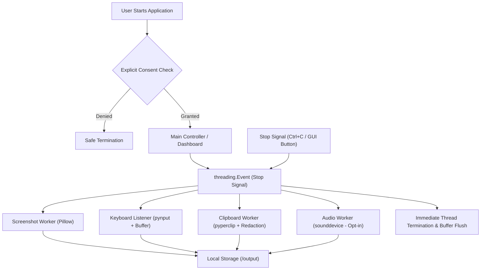

# System Activity & Exam Telemetry Suite

A lightweight, multithreaded Python desktop application designed for **authorized workstation telemetry and computer-based exam proctoring**. Built with a **Privacy-by-Design** architecture, it captures system events (screenshots, keystrokes, and clipboard modifications) locally with explicit user consent and coordinated thread synchronization.

---

## Architecture Overview



---

## Key Features

- **Concurrent Multi-Monitor Pipeline:** Dedicated worker threads capture screen frames, keyboard events, and clipboard updates asynchronously without UI blocking.
- **Privacy-by-Design & Data Masking:** Automated regular-expression filtering masks credit card numbers (`16-digit cards`) and password strings (`[REDACTED]`) before persistence.
- **Buffered Keystroke Processing:** In-memory queue buffering writes keys in batches, eliminating OS disk bottlenecks and latency during rapid typing.
- **Immediate Graceful Shutdown:** Employs `threading.Event` signaling rather than blocking sleeps, enabling complete system shutdown in under 500 milliseconds without file corruption.
- **Enterprise-Grade Logging & Rotation:** Built-in `RotatingFileHandler` bounds disk usage to 1MB per log with automatic rotation.
- **Dual Interfaces (CLI & Desktop GUI):** Run seamlessly via terminal (`main.py`) or through a clean, zero-dependency desktop control center (`dashboard.py`).
- **Data Purge Capability:** Integrated command-line (`--purge`) and GUI button to wipe collected test records (GDPR compliance / Right to Erasure).

---

## Project Structure

```text
├── config.py           # Portable relative paths, intervals, and audio flags
├── monitors.py         # Concurrent worker routines (screen, clipboard, keys, audio)
├── privacy.py          # Consent prompt, regex data sanitization, and data purge utility
├── logger_setup.py     # Centralized logging with RotatingFileHandler
├── dashboard.py        # Desktop GUI control center built with Tkinter
├── main.py             # CLI application entry point and signal orchestrator
├── test_monitor.py     # Automated unit test suite using unittest
├── requirements.txt    # Project dependencies
└── .gitignore          # Git exclusion rules for telemetry and cache artifacts
```

---

## Installation & Setup

### 1. Prerequisites
- Python 3.9+ (Windows, Linux, or macOS)
- Git

### 2. Clone Repository & Setup Virtual Environment
```bash
git clone https://github.com/yourusername/system-activity-monitor.git
cd system-activity-monitor

# Create virtual environment
python -m venv venv

# Activate virtual environment
# Windows (PowerShell):
.\venv\Scripts\Activate.ps1
# Linux / macOS:
source venv/bin/activate
```

### 3. Install Dependencies
```bash
pip install -r requirements.txt
```

---

## How to Run

### Option A: Desktop GUI Control Center (Recommended)
```bash
python dashboard.py
```
- Click **Start Monitoring** (Interactive consent dialog will appear).
- View live counters for screenshots, keystrokes, and clipboard events.
- Click **Stop Monitoring** or **Purge Test Data** at any time.
- Click **Open Output Folder** to inspect saved artifacts.

### Option B: Terminal / CLI Mode
```bash
python main.py
```
- Type `y` to grant explicit consent.
- Press `Ctrl + C` at any time to trigger immediate graceful shutdown.

### Option C: Wipe Test Data (CLI)
```bash
python main.py --purge
```

---

## Automated Unit Testing

Run the test suite using Python's built-in `unittest` runner:
```bash
python -m unittest test_monitor.py
```

### What the Tests Verify:
1. **Config Safety Defaults:** Confirms audio is strictly disabled by default.
2. **Card Masking:** Verifies 16-digit credit card patterns are masked with `[REDACTED_CARD_NUMBER]`.
3. **Password Masking:** Confirms credential substrings are replaced with `[REDACTED_PASSWORD]`.
4. **Non-Sensitive Text Preservation:** Confirms normal strings are untouched.
5. **Immediate Thread Unblocking:** Verifies `threading.Event.wait()` unblocks in milliseconds upon signal.
6. **Data Purge Verification:** Verifies the purge utility removes test files safely.

---

## Ethical Disclosure & Privacy Statement

This software is developed strictly for **educational demonstrations, authorized computer-based exam proctoring, and personal productivity auditing**. 

It adheres to defensive engineering standards:
- Requires **informed, explicit user consent** prior to recording.
- Stores telemetry **strictly on the local filesystem** with zero unauthorized network transmission.
- Implements **sensitive data redaction** to safeguard credentials.
- Strictly excludes stealth hooks, unauthorized surveillance, or persistence evasion mechanisms.
